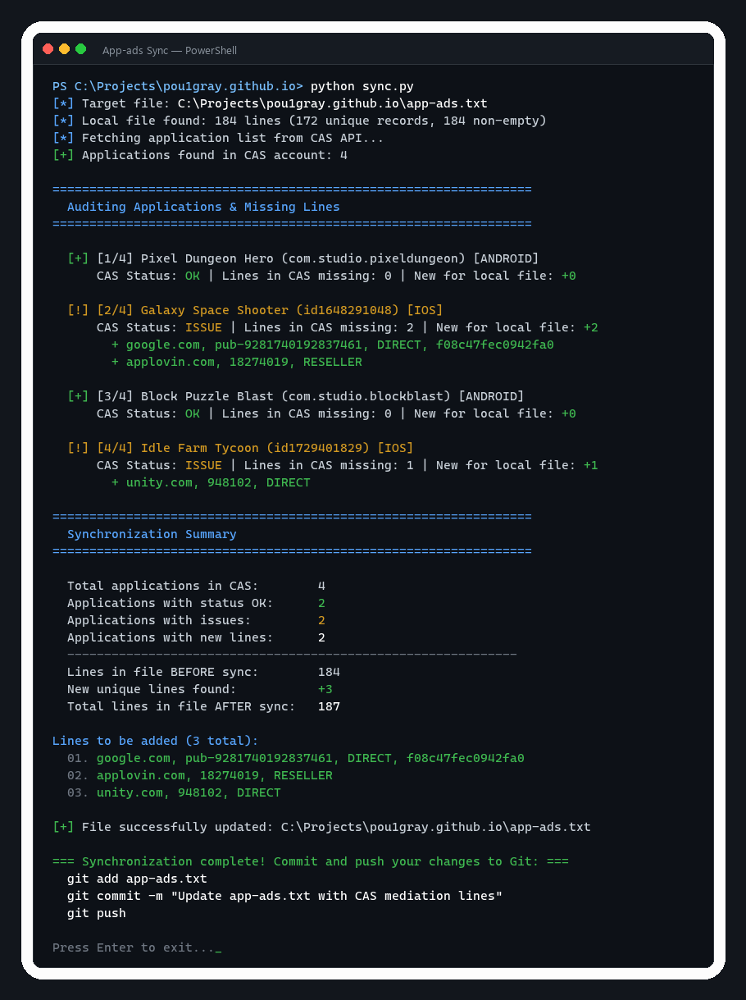

# App-ads Sync

[](https://github.com/pou1gray/App-ads-txt-Sync/actions/workflows/ci.yml)
[](https://www.python.org/)
[](LICENSE)
[](sync.py)

Cross-platform tool to automatically audit, synchronize, and merge missing `app-ads.txt` records from **Clever Ads Solutions (CAS.AI) Platform API** into your local `app-ads.txt` file.

Works out of the box on **Windows, macOS, and Linux** with **zero external pip dependencies** (built strictly with the Python standard library).

<p align="center">
  
</p>

---

## Features

- **Direct CAS API Integration**: Connects to the official [CAS Platform API v2](https://platform-api.cas.ai/docs/api).
- **Two Easy Authentication Options**:
  - **Login & Password**: Use your standard CAS account credentials (the password is used only in memory to obtain an API token and is **never** saved to disk).
  - **API Token**: Use an existing permanent token or session token (from DevTools or environment).
- **Per-Application Audit**: Iterates through all applications in your CAS account and queries missing lines (`AppAdsTxtPartsResource`).
- **Smart Non-Destructive Merge**:
  - Automatically identifies missing lines across all your apps.
  - Checks against your existing `app-ads.txt` records (canonicalizing domain, publisher ID, and account type to prevent duplicates).
  - Preserves UTF-8 and UTF-8-BOM formatting, custom entries, comments, and structure.
  - Appends only new, unique lines without touching or breaking your custom existing records.
- **Cross-Platform**: Run on Windows (`run.bat`), macOS / Linux (`run.sh`), or directly with Python.
- **Safe Modes**: Includes `--dry-run` to preview changes and `--recheck` to trigger CAS remote verification.
- **CI/CD & Headless Ready**: Support for `--no-pause` and environment variables for seamless scheduled jobs or GitHub Actions automation.

---

## Requirements

- Python 3.7+ installed. No `pip install` required!

---

## Getting Started

### 1. Clone the Repository

```bash
git clone https://github.com/pou1gray/App-ads-txt-Sync.git
cd App-ads-txt-Sync
```

### 2. Launch

**Windows:**
```bat
run.bat
```
*(or `python sync.py`)*

**macOS / Linux:**
```bash
chmod +x run.sh
./run.sh
```
*(or `python3 sync.py`)*

### 3. First Run Setup

On first launch, the program will prompt you for configuration:

1. **Authentication Method**:
   - **Method 1 (Recommended)**: Log in with your CAS Email & Password. The tool connects to `https://platform-api.cas.ai/auth/login`, obtains an access token, and saves only the token.
   - **Method 2**: Enter your token manually. You can copy it from `https://platform.cas.ai` in browser DevTools:
     `F12` &rarr; **Application** &rarr; **Local Storage** &rarr; `https://platform.cas.ai` &rarr; `onebi_actor_token`.
2. **Target File Path**: Path to your local `app-ads.txt` (for example: `C:\Projects\my-site\app-ads.txt`, `~/my-site/app-ads.txt`, or `./app-ads.txt`).

Settings are saved to `config.json` (git-ignored to protect your credentials). A reference template is provided in [`config.example.json`](config.example.json).

On subsequent runs, simply execute `run.bat` or `./run.sh`!

### 4. Commit and Push
Once the missing lines have been merged into your local repository, commit and push:
```bash
git add app-ads.txt
git commit -m "Update app-ads.txt with CAS mediation lines"
git push
```

---

## CLI Options

| Argument | Shorthand | Description |
| :--- | :--- | :--- |
| `--dry-run` | | Check and preview missing lines without modifying the file on disk |
| `--recheck` | | Request CAS to re-verify published `app-ads.txt` before fetching lines |
| `--no-pause` | | Exit immediately without waiting for keypress (ideal for CI/CD) |
| `--token` | `-t` | Specify CAS API token directly (overrides `config.json`) |
| `--target` | `-p` | Specify target `app-ads.txt` path (overrides `config.json`) |
| `--config` | `-c` | Path to custom JSON configuration file (default: `config.json`) |
| `--version` | `-v` | Show program version number and exit |
| `--help` | `-h` | Show help message and exit |

### Examples

```bash
# Preview missing lines without making changes
python sync.py --dry-run

# Request CAS to re-verify published file, then sync
python sync.py --recheck

# Non-interactive sync for automated cron/CI pipelines
python sync.py --token "$CAS_API_TOKEN" --target ./app-ads.txt --no-pause
```

### Environment Variables

You can configure credentials without modifying files:
- `CAS_API_TOKEN`: Your Clever Ads Solutions API / actor token.
- `APP_ADS_TXT_PATH`: Path to your target `app-ads.txt` file.

---

## Running Tests

Unit tests are included and use the standard Python `unittest` framework:

```bash
python -m unittest discover tests
```

---

## License

This project is licensed under the [MIT License](LICENSE).